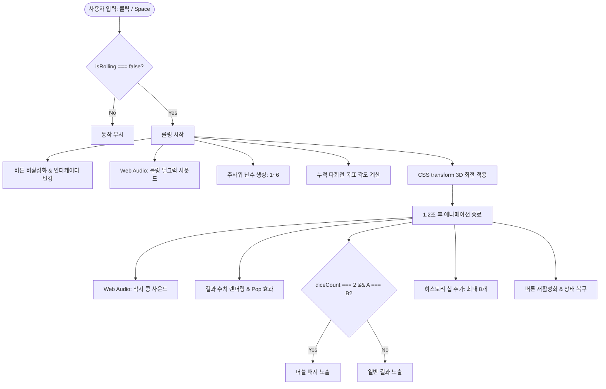

# 🎲 3D 주사위 굴리기 프로젝트 기획서 및 요구사항 명세서

본 문서는 **3D 인터랙티브 주사위 던지기 웹 애플리케이션**의 기획 배경, 요구사항 명세, 구현 아키텍처 및 상세 기술 스펙을 정리한 종합 문서입니다.

---

## 📌 목차
1. [프로젝트 개요](#1-프로젝트-개요)
2. [기획 목표 및 핵심 가치](#2-기획-목표-및-핵심-가치)
3. [상세 요구사항 명세 (Requirements Specification)](#3-상세-요구사항-명세-requirements-specification)
4. [프로젝트 디렉터리 및 파일 구조](#4-프로젝트-디렉터리-및-파일-구조)
5. [시스템 아키텍처 및 상태 관리](#5-시스템-아키텍처-및-상태-관리)
6. [핵심 기술 구현 상세](#6-핵심-기술-구현-상세)
7. [UI/UX 및 인터랙션 디자인](#7-uiux-및-인터랙션-디자인)
8. [테스트 및 품질 검증 기준](#8-테스트-및-품질-검증-기준)
9. [향후 고도화 및 확장 계획](#9-향후-고도화-및-확장-계획)

---

## 1. 프로젝트 개요

| 항목 | 내용 |
| :--- | :--- |
| **프로젝트명** | 3D 주사위 던지기 (Interactive 3D Game) |
| **플랫폼** | Web (데스크톱 및 모바일 반응형) |
| **주요 기술 스택** | HTML5 (Semantic & WAI-ARIA), CSS3 (3D Transform, Glassmorphism), Vanilla JavaScript (ES6+), Web Audio API |
| **외부 의존성** | 없음 (Zero External Library / Pure Vanilla Web Technology) |
| **개발 목적** | 무거운 3D 그래픽 라이브러리(Three.js 등)나 외부 오디오 파일 없이, 브라우저 표준 기술(CSS 3D & Web Audio API)만으로 고성능·고품질의 인터랙티브 3D 주사위 게임을 제작 |

---

## 2. 기획 목표 및 핵심 가치

1. **가볍고 빠른 반응성 (Zero-Dependency)**
   - 대용량 3D 렌더링 엔진이나 이미지/오디오 파일 다운로드로 인한 초기 로딩 지연을 원천 차단.
   - 단일 페이지 로드로 즉각 반응하는 초경량 웹 앱 제작.
2. **실감나는 3D 애니메이션 (Real 3D Feel)**
   - CSS `perspective`, `transform-style: preserve-3d`를 활용한 입체적인 큐브 회전.
   - 물리적 롤링 효과를 연출하기 위해 이전 회전각 기반 누적 다회전(1080°~1800°) 및 바닥 그림자 감쇠 애니메이션 적용.
3. **자체 합성 절차적 사운드 (Procedural Web Audio SFX)**
   - 별도 mp3/wav 파일 요청 없이 `AudioContext`와 `Oscillator`를 통해 주사위 굴림 소리와 바닥 안착 타격음을 수학적으로 실시간 합성.
4. **사용자 편의성 및 감성적 UI/UX**
   - 1개 / 2개 주사위 모드 전환 및 두 주사위 눈금이 같을 때 발동하는 **"LUCKY DOUBLE"** 연출.
   - 글래스모피즘(Glassmorphism) 기반 현대적 디자인과 **시스템 / 라이트 / 다크** 3-Way 테마 지원.
   - 키보드 스페이스바(<kbd>Space</kbd>) 단축키 및 접근성 준수.

---

## 3. 상세 요구사항 명세 (Requirements Specification)

### 3.1 기능적 요구사항 (Functional Requirements)

| 번호 | 구분 | 세부 요구사항 | 구현 완료 상태 |
| :---: | :--- | :--- | :---: |
| **FR-01** | **주사위 모드** | 주사위 1개 모드와 2개 모드를 탭 버튼으로 자유롭게 전환 가능해야 함. | ✅ 완료 |
| **FR-02** | **난수 생성** | 버튼 클릭 또는 단축키 입력 시 주사위마다 1부터 6까지의 균등 확률 난수를 독립 생성. | ✅ 완료 |
| **FR-03** | **3D 롤링 연출** | 생성된 난수에 해당하는 주사위 면이 정면을 바라보도록 1.2초간 부드러운 가속/감속 다회전 롤링 애니메이션 수행. | ✅ 완료 |
| **FR-04** | **결과 표시** | 1개 모드: 주사위 눈금 표시.<br>2개 모드: 두 주사위의 합계(Sum)를 메인으로 표시하고, 각각의 A·B 눈금을 서브 분해 카드로 노출. | ✅ 완료 |
| **FR-05** | **더블(Double) 감지** | 2개 모드에서 주사위 A와 B가 동일한 눈금일 경우 "✨ DOUBLE! 럭키 더블! ✨" 배지 애니메이션 노출. | ✅ 완료 |
| **FR-06** | **효과음 (SFX)** | 롤링 중 덜그럭거리는 소리와 착지 시 둔탁한 타격음을 Web Audio API로 출력. 사운드 켜기/끄기 토글 버튼 제공. | ✅ 완료 |
| **FR-07** | **히스토리 기록** | 최근 던진 결과를 최대 8개까지 칩(Chip) 형태로 보관 및 표시. '기록 비우기' 기능 제공. 더블 결과는 골드 컬러로 강조. | ✅ 완료 |
| **FR-08** | **테마 전환** | 시스템 설정 따름 / 라이트 모드 / 다크 모드 3단 전환 지원 및 `localStorage` 영구 보관. | ✅ 완료 |
| **FR-09** | **키보드 단축키** | 마우스 클릭 외에 <kbd>Space</kbd> 키를 눌러 주사위를 굴릴 수 있도록 지원 (입력 요소 포커스 상태 제외). | ✅ 완료 |
| **FR-10** | **중복 롤링 방지** | 주사위가 굴러가는 1.2초 동안은 던지기 버튼을 비활성화(`disabled`)하고 인디케이터를 펄스 애니메이션으로 표시하여 연타 방지. | ✅ 완료 |

### 3.2 비기능적 요구사항 (Non-Functional Requirements)

- **성능 (Performance)**: CSS 하드웨어 가속(GPU) `transform`, `opacity` 속성만을 사용하여 프레임 드랍(60fps 유지) 방지.
- **반응형 웹 (Responsive)**: 데스크톱 2컬럼 레이아웃(주사위 스테이지 + 사이드 결과 패널)에서 모바일 환경(820px 이하) 진입 시 1컬럼 수직 스택으로 자동 재배치.
- **접근성 (A11y)**: `role="tab"`, `aria-selected`, `aria-label`, `aria-controls` 등 WAI-ARIA 마크업을 준수하여 스크린 리더 친화적 구조 구축.

---

## 4. 프로젝트 디렉터리 및 파일 구조

```plaintext
dice/
├── dice_index.html        # 메인 웹 페이지 마크업 (Semantic HTML & SVG 아이콘)
├── css/
│   └── style.css          # CSS 변수, 3D Transform, 애니메이션, 글래스모피즘 테마
├── js/
│   └── main.js            # 상태 관리, 난수 및 회전각 연산, Web Audio SFX, 이벤트 바인딩
├── images/
│   ├── dice_1.svg         # 주사위 1번 눈금 SVG 에셋 (빨간 점)
│   ├── dice_2.svg         # 주사위 2번 눈금 SVG 에셋
│   ├── dice_3.svg         # 주사위 3번 눈금 SVG 에셋
│   ├── dice_4.svg         # 주사위 4번 눈금 SVG 에셋
│   ├── dice_5.svg         # 주사위 5번 눈금 SVG 에셋
│   └── dice_6.svg         # 주사위 6번 눈금 SVG 에셋
└── DICE_PROJECT_PLAN.md   # 본 프로젝트 기획서 및 요구사항 명세서
```

---

## 5. 시스템 아키텍처 및 상태 관리

애플리케이션은 **단일 진실 공급원(Single Source of Truth)** 원칙에 따라 중앙 상태 객체(`state`)를 기반으로 UI를 렌더링합니다.

### 5.1 중앙 애플리케이션 상태 (`state`)
```javascript
const state = {
  diceCount: 1,         // 주사위 개수 모드 (1 or 2)
  isRolling: false,     // 현재 주사위 롤링 진행 중 여부 (중복 방지 플래그)
  soundEnabled: true,   // 사운드 활성화 여부 (true | false)
  themeMode: 'system',  // 테마 모드 ('system' | 'light' | 'dark')
  rotations: [
    { x: 0, y: 0 },     // 주사위 1 (A) 누적 회전 각도
    { x: 0, y: 0 }      // 주사위 2 (B) 누적 회전 각도
  ],
  history: []           // 최근 8회 결과 객체 리스트
};
```

### 5.2 데이터 흐름 (Data Flow)


---

## 6. 핵심 기술 구현 상세

### 6.1 CSS 3D Cube 좌표계 및 면(Face) 배치
정육면체의 한 변 길이(`--dice-size: 100px`)의 절반인 **50px**만큼 각 면을 3차원 축으로 밀어내어 완벽한 3D 정육면체를 구성합니다.

| 주사위 눈금 | 클래스명 | CSS 3D 배치 (Transform) | 정면 뷰를 위한 보정 각도 (Target) |
| :---: | :---: | :--- | :--- |
| **1** | `.face-1` | `rotateY(0deg) translateZ(50px)` | `{ x: 0, y: 0 }` |
| **2** | `.face-2` | `rotateY(90deg) translateZ(50px)` | `{ x: 0, y: -90 }` |
| **3** | `.face-3` | `rotateX(90deg) translateZ(50px)` | `{ x: -90, y: 0 }` |
| **4** | `.face-4` | `rotateX(-90deg) translateZ(50px)` | `{ x: 90, y: 0 }` |
| **5** | `.face-5` | `rotateY(-90deg) translateZ(50px)` | `{ x: 0, y: 90 }` |
| **6** | `.face-6` | `rotateY(180deg) translateZ(50px)` | `{ x: 0, y: 180 }` |

- **SVG 백그라운드 렌더링**:
  CSS 점(pip) 렌더링 방식에서 벡터 SVG 에셋(`background: #999 url(../images/dice_n.svg) no-repeat center / contain;`) 방식으로 업그레이드되어 확대/축소 시에도 선명한 디스플레이를 보장합니다.

### 6.2 자연스러운 회전 누적 알고리즘 (`calculateNextAngle`)
매번 0도로 초기화한 뒤 회전하면 회전이 끊기거나 부자연스럽습니다.  
이를 방지하기 위해 **현재 누적 각도의 360도 정수배**에 **최소 3~4바퀴(1080°~1440°) 이상의 난수 회전**을 추가하고 목적지 면의 오프셋을 더합니다:
```javascript
function calculateNextAngle(diceIndex, targetVal) {
  const current = state.rotations[diceIndex];
  const targetFace = FACE_ANGLES[targetVal];

  // 3~4바퀴(1080도~1440도) 무작위 다회전 누적
  const minTurns = 3;
  const randomExtraTurnsX = (Math.floor(Math.random() * 2) + minTurns) * 360;
  const randomExtraTurnsY = (Math.floor(Math.random() * 2) + minTurns) * 360;

  const baseRoundX = Math.round(current.x / 360) * 360;
  const baseRoundY = Math.round(current.y / 360) * 360;

  const nextX = baseRoundX + randomExtraTurnsX + targetFace.x;
  const nextY = baseRoundY + randomExtraTurnsY + targetFace.y;

  state.rotations[diceIndex] = { x: nextX, y: nextY };
  return { x: nextX, y: nextY };
}
```

### 6.3 Web Audio API 기반 무음원 신시사이저 (`SoundFX`)
외부 파일 로딩 없이 오디오 노드를 생성하고 주파수(Hz)와 게인(Gain)을 제어하여 효과음을 동적으로 생성합니다.
1. **`playRoll()`**: 주사위가 공중에서 구르는 불규칙한 마찰음. 7회에 걸쳐 280~480Hz 사이의 미세한 트라이앵글 펄스를 간헐적으로 발생.
2. **`playThud()`**: 주사위가 탁자에 떨어질 때의 충격음. 저음역(150Hz)에서 40Hz로 급격히 하강하는 엔벨로프를 주어 바닥에 묵직하게 안착하는 질감 표현.

---

## 7. UI/UX 및 인터랙션 디자인

### 7.1 글래스모피즘(Glassmorphism) 및 비주얼 테마
- `backdrop-filter: blur(16px)`와 섬세한 반투명 테두리(`border: 1px solid var(--card-border)`), 그리고 은은한 배경 발광 그라디언트를 조합하여 세련된 유리 카드 형태를 구현.
- **3단계 테마 스위처**:
  - **시스템 모드 (`system`)**: OS의 다크/라이트 설정을 미디어 쿼리(`prefers-color-scheme`)로 실시간 추종.
  - **라이트 모드 (`light`)**: 화사한 인디고/슬레이트 톤과 부드러운 그림자.
  - **다크 모드 (`dark`)**: 깊은 네이비/미드나이트 배경과 네온 퍼플/핑크 앰비언트 글로우.

### 7.2 마이크로 인터랙션 (Micro-interactions)
- **주사위 바닥 그림자 (`.dice-floor-shadow`)**: 주사위가 공중에 떠올라 회전하는 동안 그림자가 `scale(0.65)`로 축소되고 투명도가 옅어져 입체적 부양감을 전달.
- **결과 숫자 팝업 (`popNum`)**: 결과 수치가 변경될 때 순간적으로 `scale(1.15)`까지 확대된 후 원위치로 튕기는 탄성 애니메이션 제공.
- **상태 인디케이터 (`.status-indicator`)**: 평상시에는 그린(Green), 회전 중에는 앰버(Amber) 컬러의 `pulse` 애니메이션으로 작동 상태 시각화.

---

## 8. 테스트 및 품질 검증 기준

| 테스트 케이스 | 검증 내용 | 기대 결과 |
| :--- | :--- | :--- |
| **TC-01** | 단일 주사위 모드 던지기 | 1개의 주사위만 회전하고 1~6 결과가 단일 표시되어야 함 |
| **TC-02** | 2개 주사위 모드 던지기 | 2개의 주사위가 동시 회전하고 상단에 합계, 하단에 개별 A/B 눈금이 분해 표기되어야 함 |
| **TC-03** | 더블(Double) 케이스 발생 | 주사위 2개의 눈금이 일치할 때 "LUCKY DOUBLE" 배지가 즉시 팝업되고 히스토리 칩이 골드 컬러로 저장되어야 함 |
| **TC-04** | 연타 방지 테스트 | 회전 애니메이션(1.2초) 진행 중 버튼 재클릭이나 Space 키 입력이 무시되어야 함 |
| **TC-05** | 사운드 음소거 테스트 | 사운드 토글 버튼 클릭 시 아이콘이 음소거 상태로 변경되고, 주사위를 굴려도 소리가 나지 않아야 함 |
| **TC-06** | 테마 영속성 테스트 | 다크 모드 선택 후 페이지를 새로고침해도 설정이 유지되어야 함 (`localStorage` 확인) |
| **TC-07** | 반응형 모바일 뷰 | 820px 이하 뷰포트에서 스테이지와 결과창이 1열 세로 스택으로 안정적으로 배치되어야 함 |

---

## 9. 향후 고도화 및 확장 계획

1. **다면체 주사위 확장 (Polyhedral Dice)**:
   - D4, D8, D10, D12, D20 등 보드게임/TRPG용 다양한 다면체 주사위 지원.
2. **확률 통계 및 분석 대시보드 (Statistics Panel)**:
   - 각 눈금별 누적 출현 횟수, 백분율(%), 이론상 확률과의 오차를 실시간 막대 그래프로 시각화.
3. **사용자 커스텀 테마 & 주사위 스킨**:
   - 주사위 색상(골드, 루비, 우드, 사이버펑크 네온 등) 선택 커스텀 팔레트 기능.
4. **마우스 드래그 & 던지기 (Gesture / Physics Roll)**:
   - 마우스나 터치 제스처로 주사위를 잡아서 원하는 방향과 세기로 던지는 드래그 인터랙션 도입.
