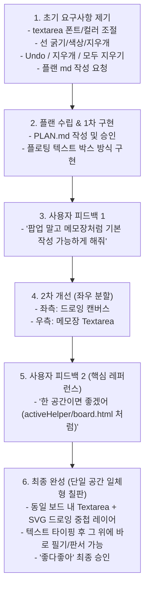

# 💬 스마트 드로잉보드 & 전자칠판 개발 대화 기록 (Conversation History)

본 문서는 사용자와 AI 어시스턴트(Antigravity) 간의 요구사항 협의, 피드백 반영, 아키텍처 진화 및 최종 구현까지의 전체 대화 과정을 정리한 기록 문서입니다.

---

## 📅 타임라인 및 대화 요약

---

## 🗣️ 단계별 대화 상세 내역

### 1단계: 초기 요구사항 및 기획 (Plan) 수립
- **사용자**:
  > "drowing 폴더의 js 활용 해서 드로잉보드 만들어거야
  > 1. textarea 의 기능이 있어야하고 폰트사이즈, 컬러 선택 가능하게 해줘
  > 2. drowing 기능에 선 굵기 조절, 색상 선택 가능하게 해주고 지우개 기능 적용해줘
  > 3. 한단계 이전 으로 가기, 지우개, 모두 지우기 기능 세가지 넣어줘
  > 플랜 먼저 md 파일로 만들어줘"
- **AI 어시스턴트**:
  - `drowing` 폴더 내 `lib-drawing-board.umd.js` 및 `drawing.js` 분석.
  - 요구사항을 3개 영역(Textarea, Drawing, Control)으로 분류하고 구현 단계 및 아키텍처를 담은 `PLAN.md` 작성 및 보고.
- **사용자**:
  > "진행하자 !"
- **AI 어시스턴트**:
  - 1차 구현 완료: 클릭 위치에 텍스트 박스를 생성하는 플로팅 텍스트 박스 + 드로잉보드 구조 생성.

---

### 2단계: 1차 피드백 (팝업 제거 및 기본 메모장 작성 요구)
- **사용자**:
  > "텍스트는 메모장 처럼 기본 으로 작성 가능하게 해줘 지금은 파업처럼 뜨고있어"
- **AI 어시스턴트**:
  - 원인 파악: 클릭 시 조그맣게 뜨는 플로팅 박스/팝업이 사용자가 원한 "메모장처럼 기본으로 작성"하는 형태와 다름을 인지.
  - 개선 진행: 팝업을 제거하고 상시 작성 가능한 대형 `<textarea>` 영역을 좌우 분할 패널(좌: 드로잉보드, 우: 메모장) 형태로 전면 개편.

---

### 3단계: 2차 피드백 및 레퍼런스 제시 (한 공간 일체형 구조 요구)
- **사용자**:
  > "음 한 공간이면 좋겠는데  
  > `http://wepub.co.kr:8080/content1/test/chunjaeCNJP/china_2022/resource/include/activeHelper/board.html`  
  > 이거처럼"
- **AI 어시스턴트**:
  - 제공된 천재교육 액티브 헬퍼 `board.html` 및 `board.js` 구조 정밀 분석.
  - **핵심 구조 발견**:
    - 분할 레이아웃이 아닌 **칠판 프레임 하나(한 공간)** 내에 **하단 Textarea 레이어**와 **상단 드로잉 레이어**가 일체형으로 중첩(Overlay)된 전자칠판 방식.
    - [텍스트 모드] 시 드로잉 레이어의 이벤트를 통과(`pointer-events: none`)시켜 보드 전체에 바로 글을 작성.
    - [펜/형광펜/지우개 모드] 시 드로잉 레이어를 활성화(`pointer-events: auto`)하여 작성된 글씨 위에 바로 필기, 판서, 밑줄 긋기 수행.
  - **3차 최종 구현**:
    - `index.html`, `style.css`, `app.js`를 단일 공간 일체형 스마트 전자칠판 구조로 전면 재구축.
- **사용자**:
  > "좋다좋아"
- **AI 어시스턴트**:
  - 최종 승인 및 완료 확인.

---

### 4단계: 대화 기록 문서화
- **사용자**:
  > "대화내용 md 파일로 만들어줄레?"
- **AI 어시스턴트**:
  - 본 `CONVERSATION_HISTORY.md` 문서 작성.

---

## 🛠️ 최종 구현 사양 정리

### 1. 주요 기능
| 기능 | 구현 내용 |
| :--- | :--- |
| **텍스트 모드 (`📝`)** | 보드 전체에 자유롭게 타이핑, 폰트 크기(14~72px) 및 글자 색상 실시간 반영 |
| **드로잉 모드 (`✏️` / `🖌️`)** | 텍스트 위에 바로 필기/판서, 선 굵기(1~60px) 및 색상 실시간 반영 |
| **지우개 모드 (`🧹`)** | 그린 선 지우기, 원형 지우개 가이드 커서 표시, 선 굵기 슬라이더로 크기 조절 |
| **한단계 이전 (Undo)** | 그린 선 실행 취소 (`Ctrl+Z` 단축키 지원) |
| **지우개 토글** | 원클릭 지우개 모드 전환 버튼 |
| **모두 지우기** | 보드의 글씨와 드로잉 선 일괄 삭제 (컨펌 지원, 글씨만/선만 개별 지우기도 지원) |
| **보드 저장 (`💾`)** | 작성된 텍스트와 드로잉 선을 합성하여 PNG 이미지 다운로드 |

### 2. 프로젝트 파일 구성
* [`index.html`](file:///c:/Users/user/Desktop/work/study/drowing/index.html): 단일 공간 일체형 전자칠판 프레임 마크업
* [`css/style.css`](file:///c:/Users/user/Desktop/work/study/drowing/css/style.css): 칠판 프레임 및 중첩 레이어 포인터 스타일시트
* [`js/app.js`](file:///c:/Users/user/Desktop/work/study/drowing/js/app.js): 일체형 텍스트-드로잉 모드 전환 및 통합 제어 모듈
* [`PLAN.md`](file:///c:/Users/user/Desktop/work/study/drowing/PLAN.md): 전자칠판 시스템 기획 및 명세서
* [`CONVERSATION_HISTORY.md`](file:///c:/Users/user/Desktop/work/study/drowing/CONVERSATION_HISTORY.md): 전체 대화 및 개발 기록 (본 문서)

