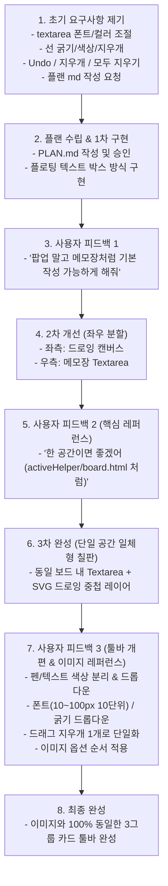

# 💬 스마트 드로잉보드 & 전자칠판 개발 대화 기록 (Conversation History)

본 문서는 사용자와 AI 어시스턴트(Antigravity) 간의 요구사항 협의, 피드백 반영, 아키텍처 진화 및 최종 구현까지의 전체 대화 과정을 정리한 기록 문서입니다.

---

## 📅 타임라인 및 대화 요약

---

## 🗣️ 단계별 대화 상세 내역

### 1단계: 초기 요구사항 및 기획 (Plan) 수립
- **사용자**:
  > "drowing 폴더의 js 활용 해서 드로잉보드 만들어거야  
  > 1. textarea 의 기능이 있어야하고 폰트사이즈, 컬러 선택 가능하게 해줘  
  > 2. drowing 기능에 선 굵기 조절, 색상 선택 가능하게 해주고 지우개 기능 적용해줘  
  > 3. 한단계 이전 으로 가기, 지우개, 모두 지우기 기능 세가지 넣어줘  
  > 플랜 먼저 md 파일로 만들어줘"
- **AI 어시스턴트**: `PLAN.md` 수립 및 1차 구현 (플로팅 텍스트 박스 방식).

---

### 2단계: 1차 피드백 (팝업 제거 및 기본 메모장 작성 요구)
- **사용자**:
  > "텍스트는 메모장 처럼 기본 으로 작성 가능하게 해줘 지금은 파업처럼 뜨고있어"
- **AI 어시스턴트**: 팝업 제거, 좌우 분할 패널(좌: 드로잉, 우: 메모장)로 개편.

---

### 3단계: 2차 피드백 및 레퍼런스 제시 (한 공간 일체형 칠판)
- **사용자**:
  > "음 한 공간이면 좋겠는데  
  > `http://wepub.co.kr:8080/content1/test/chunjaeCNJP/china_2022/resource/include/activeHelper/board.html`  
  > 이거처럼"
- **AI 어시스턴트**: 참조 사이트 분석 후, 단일 칠판 프레임 내 하단 Textarea와 상단 드로잉 레이어를 중첩한 일체형 전자칠판 구축.
- **사용자**:
  > "좋다좋아"

---

### 4단계: 3차 피드백 (이미지 레퍼런스 기반 툴바 전면 개편)
- **사용자**:
  > "- 색상 선택 펜이랑 텍스트 따로 주고 드롭다운으로 해줘  
  > - 폰트 사이즈, 선 굵기도 드롭다운으로  
  > - 폰트사이즈는 슬라이드바 말구 10px~100px 10단위로 끊어서 선택 가능 하도록  
  > - 드래그 지우개 버튼은 하나만 두자 지금은 두 개야  
  > - 보내준 이미지 옵션 순서처럼 해줘"  
  > *(첨부 이미지: 3개의 둥근 사각 그룹 박스로 이루어진 툴바)*
- **AI 어시스턴트**:
  - **이미지 100% 동일 레이아웃 구축**:
    - **[Group 1: 텍스트]**: `[ 가 ]` `[ 폰트크기 ▼ ]` (10~100px 10단위 드롭다운) `[ 색상 ▼ ]` (텍스트 전용)
    - **[Group 2: 펜]**: `[ ✏️ ]` `[ 굵기 ▼ ]` (드롭다운) `[ 색상 ▼ ]` (펜 전용)
    - **[Group 3: 제어]**: `[ ↩️ ]` `[ 🧹 ]` (단일 드래그 지우개!) `[ 🧹✏️ ]` (선만 지우기) `[ 🗑️ ]` (모두 지우기)
  - 텍스트 색상과 펜 색상을 완전히 독립 변수로 분리하여 상호 간섭 없도록 개선.

---

## 🛠️ 최종 구현 사양 정리

### 1. 툴바 상세 스펙
1. **텍스트 그룹**:
   - `[ 가 ]`: 클릭 시 텍스트 모드로 전환 및 textarea 포커스
   - `[ 폰트크기 ▼ ]`: 10px, 20px, 30px, 40px, 50px, 60px, 70px, 80px, 90px, 100px 선택
   - `[ 색상 ▼ ]`: 텍스트 글자색 전용 프리셋 팔레트 및 컬러 피커
2. **펜 드로잉 그룹**:
   - `[ ✏️ ]`: 클릭 시 펜 드로잉 모드로 전환
   - `[ 굵기 ▼ ]`: 2px, 4px, 8px, 12px, 16px, 24px, 32px 선택
   - `[ 색상 ▼ ]`: 펜 선 전용 프리셋 팔레트 및 컬러 피커
3. **제어 그룹**:
   - `[ ↩️ ]`: 실행 취소 (Undo, `Ctrl+Z`)
   - `[ 🧹 ]`: 드래그 지우개 도구 (단 하나로 정리!)
   - `[ 🧹✏️ ]`: 입력한 글씨는 남겨두고 드로잉 선만 일괄 삭제
   - `[ 🗑️ ]`: 글씨와 드로잉 선 모두 삭제
   - `[ 💾 ]`: 텍스트와 드로잉을 합성한 PNG 이미지 다운로드

### 2. 프로젝트 소스 파일
* [`index.html`](file:///c:/Users/user/Desktop/work/study/drowing/index.html): 이미지 기반 3그룹 툴바 및 일체형 칠판 마크업
* [`css/style.css`](file:///c:/Users/user/Desktop/work/study/drowing/css/style.css): 연두빛 툴바 배경, 카드형 그룹 및 커스텀 드롭다운 스타일
* [`js/app.js`](file:///c:/Users/user/Desktop/work/study/drowing/js/app.js): 텍스트/펜 독립 속성, 드롭다운 제어 총괄 모듈
* [`PLAN.md`](file:///c:/Users/user/Desktop/work/study/drowing/PLAN.md): 전자칠판 최신 개발 명세서
* [`CONVERSATION_HISTORY.md`](file:///c:/Users/user/Desktop/work/study/drowing/CONVERSATION_HISTORY.md): 본 문서
