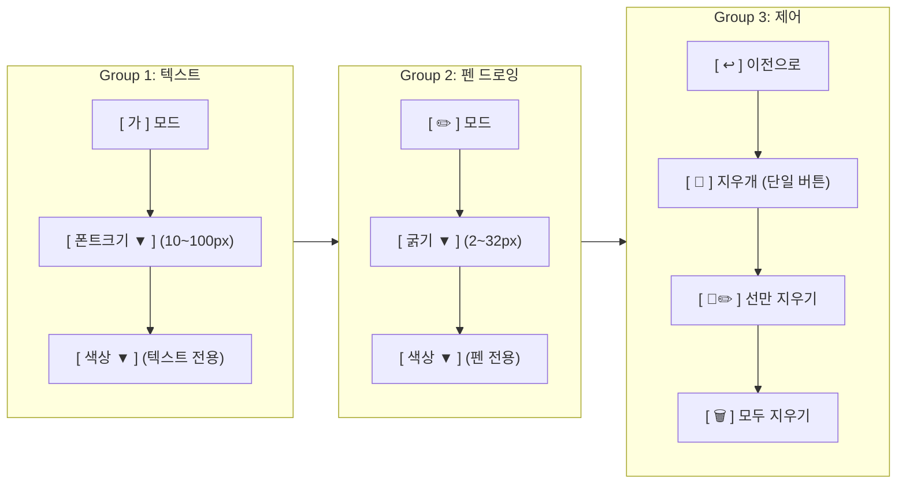

# 🎨 스마트 전자칠판 (Smart Board) 개발 명세서

참조 이미지 레이아웃 및 옵션 순서를 기반으로, **텍스트와 펜 속성이 완전히 분리된 3그룹 드롭다운 툴바 및 일체형 전자칠판 시스템**으로 개발되었습니다.

---

## 📌 1. 툴바 그룹 및 옵션 순서 (이미지 레퍼런스 100% 반영)



### 1) [Group 1: 텍스트]
* **`[ 가 ]` 버튼**: 텍스트 입력 모드 활성화 (보드 전체에 바로 타이핑)
* **`[ 폰트크기 ▼ ]` 드롭다운**: 슬라이더 대신 **10px ~ 100px (10단위: 10, 20, 30, 40, 50, 60, 70, 80, 90, 100px)** 선택 지원
* **`[ 색상 ▼ ]` 드롭다운**: **텍스트 글자 전용** 색상 팔레트 및 커스텀 컬러 피커

### 2) [Group 2: 펜 드로잉]
* **`[ ✏️ ]` 버튼**: 펜 드로잉 모드 활성화 (작성된 글씨 위에 자유롭게 필기/판서)
* **`[ 굵기 ▼ ]` 드롭다운**: 슬라이더 대신 **2px, 4px, 8px, 12px, 16px, 24px, 32px** 등 굵기 드롭다운 선택 지원
* **`[ 색상 ▼ ]` 드롭다운**: **펜 선 전용** 색상 팔레트 및 커스텀 컬러 피커 (텍스트 색상과 완전 분리)

### 3) [Group 3: 제어 관련]
* **`[ ↩️ ]` 이전으로 (Undo)**: 그린 선을 한단계 되돌리기 (`board.undo()`, 단축키 `Ctrl+Z`)
* **`[ 🧹 ]` 지우개 도구 (단일 버튼)**: 중복되었던 지우개 버튼을 하나로 통합! 마우스 드래그로 선을 지우는 모드로 전환
* **`[ 🧹✏️ ]` 선만 지우기**: 입력한 텍스트 글씨는 보존하고, 그린 선만 한 번에 일괄 삭제
* **`[ 🗑️ ]` 모두 지우기**: 글씨와 드로잉 선을 모두 한 번에 깨끗이 초기화 (컨펌 창 제공)
* **`[ 💾 ]` 저장**: 글씨와 드로잉을 합성하여 PNG 이미지 파일로 다운로드

---

## 📁 2. 프로젝트 파일 구성

```
drowing/
├── index.html                 # 3그룹 툴바 및 단일 공간 일체형 전자칠판 마크업
├── PLAN.md                    # 본 명세서
├── CONVERSATION_HISTORY.md    # 전체 대화 및 개발 기록
├── css/
│   └── style.css              # 이미지 기반 연두빛 툴바, 카드형 그룹, 커스텀 드롭다운 및 칠판 스타일
└── js/
    ├── lib-drawing-board.umd.js # SVG 드로잉 엔진 컴포넌트
    └── app.js                 # 텍스트/펜 독립 속성, 드롭다운 제어 및 이벤트 총괄 모듈
```
